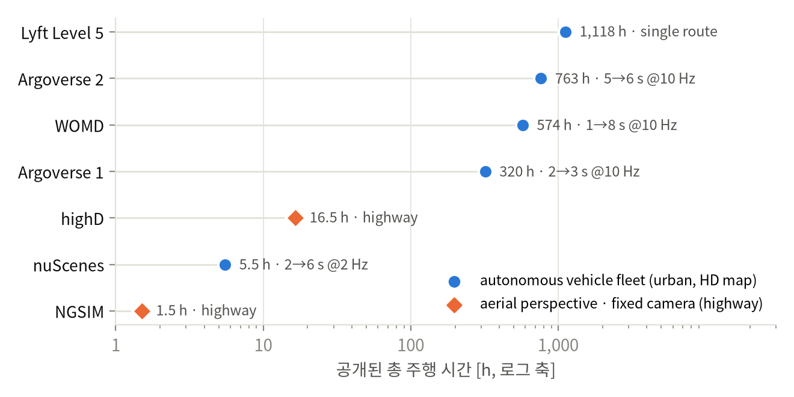
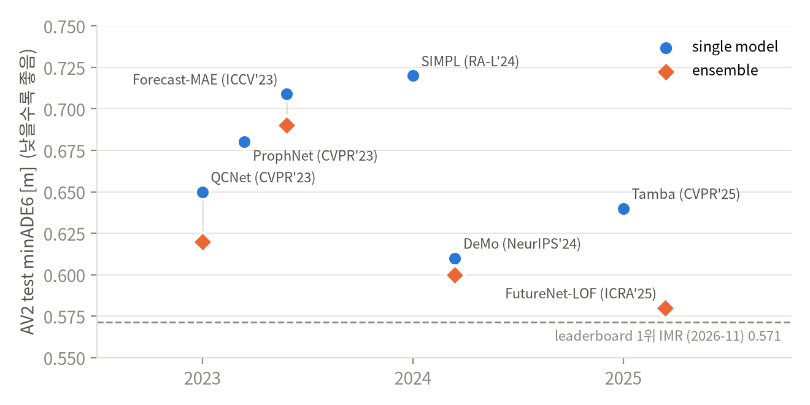

# 최신 연구 환경 변화에 대한 조사 — 자율주행 데이터셋 · 최신 SOTA 모델

> 연차보고서 PART 1 「인지 증강화 기반 동적 객체 이동 궤적 예측 모델 개발」 중 **김영진 담당(1~2쪽)** · 초안 2026-11-10
> 작년 보고서와 같은 개조식("~함 / ~임"), 소제목마다 그림·표 하나. 고유 용어는 각 논문·공식 페이지의 원문 표기를 따름. 출처 링크는 맨 아래 「출처」에 있음

---

## 1. 자율주행 데이터셋 조사

### 1.1 데이터셋의 종류와 수집 방식

- 궤적 예측(motion forecasting) 연구는 공개 데이터셋과 그 benchmark·leaderboard 를 중심으로 발전해 왔음
- 수집 방식에 따라 두 갈래로 나뉨
  - **자율주행 차량 fleet 수집** — 차량에 탑재한 camera·lidar·radar 로 주변 객체를 검출·추적한 결과를 궤적으로 공개함. 주행 로그 중 "interesting and challenging interactions" 가 있는 구간을 mining 해서 구성하고, 대부분 HD map 을 함께 제공함 (Argoverse 1·2, WOMD, nuScenes, Lyft Level 5)
  - **aerial perspective(drone)·고정 camera 촬영** — 도로를 위에서 촬영해 차량을 추적함. 가림이 없어 위치가 정밀하나 highway 구간에 한정되고 교차로·HD map 이 없음 (highD, NGSIM)
- fleet 수집 데이터도 tracker 출력이므로 잡음이 있음. 본 과제 실측에서 AV2 의 heading 은 진행 방향이 아니라 차체(bounding box) 방향이었고, 11초 window 양 끝 0.5초의 위치 차분 속력이 실제의 약 절반으로 나타남

> 그림 1. 주요 궤적 예측 데이터셋의 공개 규모(총 주행 시간)와 observation→prediction 구간 — Argoverse 1 은 전체 로그 1,006 h 중 공개된 320 h, nuScenes 는 annotation 된 scene 기준

### 1.2 데이터 특성과 활용 과제

| Dataset (공개) | 지역 | 규모 | observation→prediction | map | task · metric |
| --- | --- | --- | --- | --- | --- |
| Argoverse 1 (2019, CVPR) | Pittsburgh, Miami | 324,557 scenarios × 5 s | 2 s→3 s, 10 Hz | vector map of lane centerlines, driveable area, ground height | Motion Forecasting · minADE / minFDE / MR / DAC |
| Argoverse 2 (2021, NeurIPS) | 미국 6개 도시 | 250,000 scenarios × 11 s (763 h) | 5 s→6 s, 10 Hz | scenario 별 HD Map — lane graph(lane segments, 3D lane boundaries), crosswalks | Motion Forecasting (single-agent / multi-agent) · minADE6 / minFDE6 / MR6 / brier-minFDE6 |
| WOMD (2021, ICCV) | 미국 6개 도시 | 103,354 segments × 20 s (574 h) | 1 s→8 s, 10 Hz | lane centers, lane boundary lines, road edges, stop signs, crosswalks, speed bumps + traffic signal states | Motion Prediction, Interaction Prediction, Sim Agents · Soft mAP / mAP / minADE / MR |
| nuScenes (2020, CVPR) | Boston, Singapore | 1,000 scenes × 20 s | 2 s→6 s, 2 Hz | semantic map (11 semantic layers) | 3D detection·tracking + Prediction challenge · minADE_k / minFDE_k / MissRate_2_k / OffRoadRate |
| Lyft Level 5 (2020, CoRL) | Palo Alto 단일 route | 170,000 scenes × 25 s (1,118 h) | 5 s prediction(baseline), 10 Hz | HD semantic map (15,242 labelled elements) + aerial view | motion forecasting, motion planning, simulation |
| highD (2018, ITSC) | 독일 highway 6개 지점 | 110,000 vehicles (16.5 h) | 공식 prediction task 없음, 25 fps | — | scenario-based safety validation |
| NGSIM (2006) | 미국 highway | 9,206 vehicles (1.5 h) | 공식 prediction task 없음 | — | 연속류 궤적 예측 (본 과제 3차년도 사용) |

- **prediction horizon 이 길어지고 규모가 커짐** — Argoverse 1 3초 → Argoverse 2 6초 → WOMD 8초, 2개 도시 → 6개 도시. 3초로 학습한 model 을 6초로 평가하면 minFDE 가 2.91 → 6.82 m 로 커져(Argoverse 2 논문) 긴 horizon 전용 설계가 필요해짐
- **map 이 vector HD map 으로 표준화됨** — VectorNet 이후 raster(bird-eye image) 대신 vectorized HD map 을 쓰는 것이 일반화됐고, Argoverse 2 는 3D lane boundaries·crosswalks, WOMD 는 traffic signal states 까지 제공함
- **task 가 single-agent → multi-agent·generative 로 확장됨** — WOMD Interaction Prediction(joint prediction), Argoverse 2 multi-agent forecasting, Sim Agents. Waymo Open Dataset 2025 Challenges 는 Motion Prediction 트랙 없이 E2E Driving, Scenario Generation, Sim Agents, Interaction Prediction 으로 운영됨
- **metric 이 확률 품질 쪽으로 이동함** — min-of-K 거리 지표(minADE)는 K 를 늘리면 계속 좋아지는 한계가 있어, WOMD 는 mAP(Soft mAP), Argoverse 2 는 brier-minFDE 로 순위를 매김
- **Argoverse 2 활용 사례** — leaderboard 상위 model(QCNet, DeMo, FutureNet-LOF), 경량 baseline(SIMPL), map 을 쓰지 않는 공개 구현 MFTF(Map Free Motion Forecasting Using Transformers, CRAT-Pred 기반)까지 폭넓게 쓰임. 본 과제도 Argoverse 2 를 주 데이터로 사용함

---

## 2. 최신 SOTA 모델 조사

### 2.1 모델 계보

- **vectorized representation 의 등장 (2020)** — VectorNet 이 vectorized HD map 과 agent trajectory 를 hierarchical graph neural network 로 인코딩했고, LaneGCN 이 lane graph 위에서 actor-to-lane·lane-to-lane·lane-to-actor·actor-to-actor 4종 interaction 으로 융합함 → bird-eye image + ConvNet 방식을 대체함
- **Transformer 와 invariance (2022)** — HiVT 가 translation-invariant scene representation 과 rotation-invariant spatial learning modules 를 제안했고, MTR 이 learnable motion query pairs 로 global intention localization 과 local movement refinement 를 함께 최적화해 WOMD 에서 1위를 차지함
- **query-centric·self-supervised learning (2023)** — QCNet 이 query-centric paradigm 으로 past computations 를 재사용해(encoder 지연 82 → 13 ms) Argoverse 2 1위에 올랐고, Forecast-MAE 가 masked autoencoders 기반 self-supervised pre-training 을 도입함
- **language modeling·generative (2023~2024)** — MotionLM 이 궤적을 discrete motion tokens 로 바꿔 multi-agent motion prediction 을 language modeling task 로 풀었고, SMART 가 vectorized map 까지 discrete sequence tokens 로 만들어 decoder-only transformer 의 next token prediction 으로 Sim Agents 2024 에서 realism 0.7614 로 1위를 함
- **경량화·query 분해·state space model (2024~2025)** — SIMPL(1.9M parameters, symmetric global feature fusion), DeMo(mode queries 와 state queries 분리 + Attention·Mamba), Trajectory Mamba(selective state-space model 로 self-attention 대체), FutureNet-LOF(future context encoding + Lane Occupancy Field)

> 그림 2. Argoverse 2 test single-agent minADE6(K=6, 5 s→6 s) — 논문 보고치. 같은 해 안의 가로 위치는 겹치지 않게 벌린 것임. 점선은 2026-11-10 leaderboard 1위의 값

| Model | 발표 | 핵심 (원문 표기) | minADE6 | minFDE6 | 비고 |
| --- | --- | --- | --- | --- | --- |
| QCNet | CVPR 2023 | query-centric paradigm, anchor-free queries → anchor-based refinement | 0.65 | 1.29 | ensemble 0.62 / 1.19 |
| ProphNet | CVPR 2023 | agent-centric model with anchor-informed proposals | 0.68 | 1.33 | 코드 미공개 |
| Forecast-MAE | ICCV 2023 | masked autoencoders, self-supervised pre-training | 0.709 | 1.392 | ensemble 0.690 / 1.338 |
| SIMPL | RA-L 2024 | symmetric global feature fusion, Bernstein basis polynomials | 0.72 | 1.43 | 1.9M, 공개 코드 |
| DeMo | NeurIPS 2024 | mode queries + state queries, Attention and Mamba | 0.61 | 1.17 | ensemble 0.60 / 1.11 |
| Trajectory Mamba | CVPR 2025 | selective state-space model (SSM), joint polyline encoding | 0.64 | 1.24 | 4.54M, ensemble 여부 미기재 |
| FutureNet-LOF | ICRA 2025 | future context encoding, Lane Occupancy Field (LOF) | 0.58 | 1.07 | ensemble |
| IMR (leaderboard 1위) | 2025-09 제출 | 논문 미확인 | 0.5714 | 1.0684 | brier-minFDE6 1.6248 |

- WOMD(1 s→8 s, K=6) 대표 기록 — MTR mAP 0.4129, MTR++ mAP 0.4329, EDA Soft mAP 0.4510(이상 test), 2024 Motion Prediction Challenge 1위 MTR v3 Soft mAP 0.4967(ensemble), 2025 Interaction Prediction Challenge 1위 Parallel ModeSeq Soft mAP 0.2978

### 2.2 연구 환경 변화와 시사점

- **성능 포화와 ensemble 의존** — Argoverse 2 test minADE6 상위권이 0.57~0.65 m 에 모였고 상위 기록 다수가 ensemble 임 → single model 을 같은 조건에서 비교해야 차이가 드러남
- **거리 지표 외 평가의 부재** — 상위 model 대부분이 off-road·역주행 같은 map 준수 지표를 보고하지 않음. WOSAC 2023 에서는 minADE 1위 model(QCNeXt, 1.083)의 off-road likelihood 가 최하위(0.360)였음 → map 규칙 준수와 kinematic feasibility 를 함께 보는 평가가 필요함
- **재현 장벽** — 일부 상위 model 은 코드가 공개되지 않았고(ProphNet), 일부는 multi-GPU 학습을 전제로 함(QCNet) → 공개 코드·single GPU 로 재현 가능한 경량 model 의 가치가 커짐
- **task 의 확장** — single-agent prediction 에서 multi-agent joint prediction, Sim Agents, E2E Driving 으로 연구 범위가 넓어지는 추세임

---

## 출처

**데이터셋**

| 항목 | 링크 |
| --- | --- |
| Argoverse 1 (324,557 scenarios, 1,006 h 중 320 h, 2 s→3 s, DAC) | https://arxiv.org/abs/1911.02620 |
| Argoverse 2 (250,000 scenarios, 763 h, 6개 도시, 3 s 학습→6 s 평가 minFDE 2.91 → 6.82) | https://arxiv.org/abs/2301.00493 · https://www.argoverse.org/av2.html |
| WOMD (103,354 segments, 574 h, 6개 도시, v1.3.1) | https://waymo.com/open/about/ · 원논문 https://arxiv.org/abs/2104.10133 |
| nuScenes (1,000 scenes, 6 cameras · 5 radars · 1 lidar) | https://arxiv.org/abs/1903.11027 |
| nuScenes Prediction challenge (2 s→6 s @2 Hz, metric) | https://github.com/nutonomy/nuscenes-devkit/blob/master/python-sdk/nuscenes/eval/prediction/README.md |
| Lyft Level 5 (1,118 h, 170,000 scenes, 15,242 labelled elements) | https://arxiv.org/abs/2006.14480 |
| highD (16.5 h, 110,000 vehicles, 6 locations) · NGSIM 수치(highD 논문 Table I) | https://doi.org/10.1109/ITSC.2018.8569552 |
| NGSIM 데이터 | https://data.transportation.gov/Automobiles/Next-Generation-Simulation-NGSIM-Vehicle-Trajector/8ect-6jqj |
| Waymo Open Dataset Challenges (2025 트랙 구성) | https://waymo.com/open/challenges/ |

**모델**

| 항목 | 링크 |
| --- | --- |
| VectorNet | https://arxiv.org/abs/2005.04259 |
| LaneGCN | https://arxiv.org/abs/2007.13732 |
| HiVT | https://doi.org/10.1109/CVPR52688.2022.00862 |
| MTR (WOMD mAP 0.4129) | https://arxiv.org/abs/2209.13508 |
| MTR++ (WOMD mAP 0.4329) | https://arxiv.org/abs/2306.17770 |
| EDA (WOMD Soft mAP 0.4510) | https://arxiv.org/abs/2312.09501 |
| QCNet (Table 1, encoder 82 → 13 ms) | https://doi.org/10.1109/CVPR52729.2023.01713 |
| ProphNet | https://arxiv.org/abs/2303.12071 |
| Forecast-MAE | https://arxiv.org/abs/2308.09882 |
| MotionLM | https://arxiv.org/abs/2309.16534 |
| SMART (Sim Agents realism 0.7614, QCNeXt minADE 1.083 / off-road 0.360) | https://arxiv.org/abs/2405.15677 |
| SIMPL | https://arxiv.org/abs/2402.02519 |
| DeMo | https://arxiv.org/abs/2410.05982 |
| Trajectory Mamba | https://arxiv.org/abs/2503.10898 |
| FutureNet-LOF | https://arxiv.org/abs/2406.14422 |
| Argoverse 2 leaderboard (IMR, 2026-11-10 조회) | https://eval.ai/web/challenges/challenge-page/1719/leaderboard/4098 |
| 2024 Motion Prediction Challenge 1위 MTR v3 | https://storage.googleapis.com/waymo-uploads/files/research/2024%20Technical%20Reports/2024%20WOD%20Motion%20Prediction%20Challenge%20-%201st%20Place%20-%20MTR%20v3.pdf |
| 2025 Interaction Prediction Challenge 1위 Parallel ModeSeq | https://storage.googleapis.com/waymo-uploads/files/research/2025%20Technical%20Reports/2025%20WOD%20Interaction%20Prediction%20Challenge%20-%201st%20Place%20-%20Parallel%20ModeSeq.pdf |
| MFTF | https://github.com/narsisn/Argoverse2_Motion_Forecasting |

**본 과제 실측**

| 항목 | 링크 |
| --- | --- |
| AV2 heading = bounding box 방향 | https://github.com/kiimmyj/Argoverse2study/blob/lane-rules/docs/heading_quality.md |
| window 양 끝 속도 ramp | https://github.com/kiimmyj/Argoverse2study/blob/lane-rules/docs/v4_data_cleansing.md |

---

## 작성 메모 (보고서 본문 아님)

- **MFTF 는 논문이 아니라 GitHub 공개 저장소임.** README 제목 "MFTF: Map Free Motion Forecasting Using Transformers", 부제 "Argoverse2 Motion Forecasting". CRAT-Pred 의 LSTM·self-attention 을 Transformer encoder 로 바꾼 구현이고, 결과표·저자·인용 정보가 없으며 Argoverse 2 leaderboard(196개 항목)에도 없음(2026-11-10 조회). 모델 담당의 "궤적 예측 모델링 (CVAE, MFTF)"과 겹치므로 본문에는 활용 사례 한 줄만 두었음 — 표기를 맞출 것
- 데이터셋마다 horizon·K·split 이 달라(Argoverse 1 2→3 s, Argoverse 2 5→6 s, WOMD 1→8 s) **수치를 한 표에서 우열로 비교하면 안 됨**
- Argoverse 2 의 고유 도로 길이는 논문 2,220 km, 공식 사이트 2,110 km 로 달라 본문에서 뺐음. WOMD 규모도 원논문(100,000+ scenes)과 현재 공식 페이지(103,354 segments)가 달라 공식 페이지 값을 씀
- leaderboard 값은 조회 시점(2026-11-10) 기준임. 보고서 제출 직전에 다시 확인할 것
- 그림 원본은 https://github.com/kiimmyj/Argoverse2study/blob/lane-rules/src/viz_annual_report.py 가 그림. 수치를 고칠 때는 이 스크립트의 표를 고친 뒤 다시 그림
