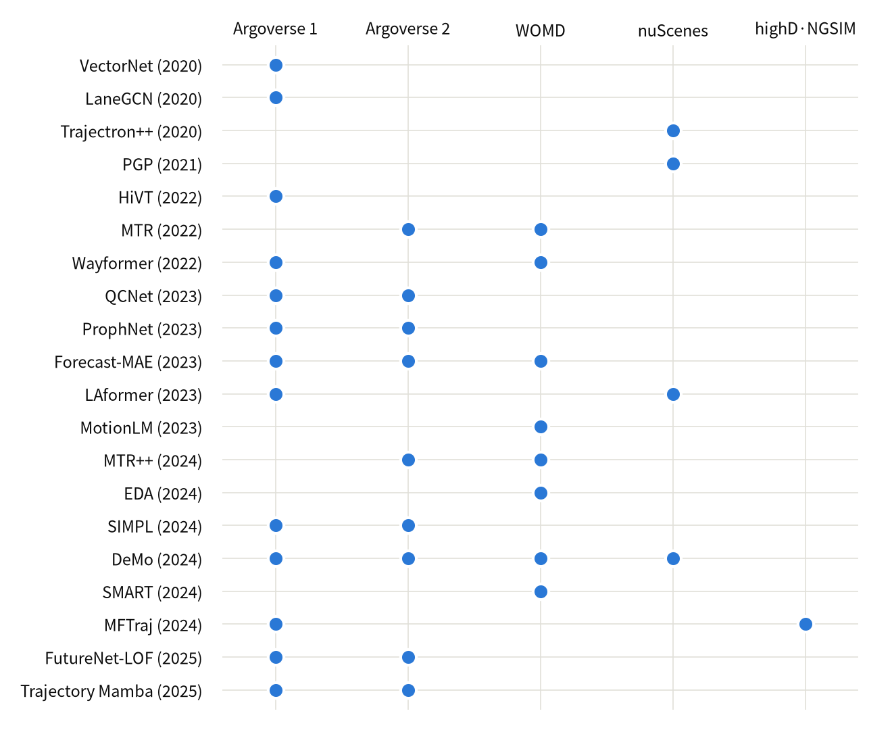

# 최신 연구 환경 변화에 대한 조사 — 자율주행 데이터셋과 SOTA 모델 활용 사례

> 연차보고서 PART 1 「인지 증강화 기반 동적 객체 이동 궤적 예측 모델 개발」 중 **김영진 담당(1~2쪽)** · 초안 2026-11-10
> 작년 보고서와 같은 개조식("~함 / ~임"). 데이터셋을 조사하고, **각 데이터셋을 사용한 SOTA 모델 사례를 데이터셋별로 비교**함. 고유 용어는 각 논문·공식 페이지의 원문 표기를 따르고, 출처 링크는 맨 아래 「출처」에 있음

---

## 1. 자율주행 데이터셋 조사

### 1.1 데이터셋의 종류와 수집 방식

- 궤적 예측(motion forecasting) 연구는 공개 데이터셋과 그 benchmark·leaderboard 를 중심으로 발전해 왔음
- 수집 방식에 따라 두 갈래로 나뉨
  - **autonomous vehicle fleet 수집** — 차량에 탑재한 camera·lidar·radar 로 주변 객체를 검출·추적한 결과를 궤적으로 공개함. 주행 로그 중 "interesting and challenging interactions" 가 있는 구간을 mining 해서 구성하고, 대부분 HD map 을 함께 제공함 (Argoverse 1·2, WOMD, nuScenes, Lyft Level 5)
  - **aerial perspective(drone)·고정 camera 촬영** — 도로를 위에서 촬영해 차량을 추적함. 가림이 없어 위치가 정밀하나 highway 구간에 한정되고 교차로·HD map 이 없음 (highD, NGSIM)
- fleet 수집 데이터도 tracker 출력이므로 잡음이 있음. 본 과제 실측에서 Argoverse 2 의 heading 은 진행 방향이 아니라 차체(bounding box) 방향이었고, 11초 window 양 끝 0.5초의 위치 차분 속력이 실제의 약 절반으로 나타남

> 그림 1. 주요 궤적 예측 데이터셋의 공개 규모(총 주행 시간)와 observation→prediction 구간 — Argoverse 1 은 전체 로그 1,006 h 중 공개된 320 h, nuScenes 는 annotation 된 scene 기준

### 1.2 데이터 특성

| Dataset (공개) | 지역 | 규모 | observation→prediction | map | task · metric |
| --- | --- | --- | --- | --- | --- |
| Argoverse 1 (2019, CVPR) | Pittsburgh, Miami | 324,557 scenarios × 5 s | 2 s→3 s, 10 Hz | vector map of lane centerlines, driveable area, ground height | Motion Forecasting · minADE / minFDE / MR / DAC |
| Argoverse 2 (2021, NeurIPS) | 미국 6개 도시 | 250,000 scenarios × 11 s (763 h) | 5 s→6 s, 10 Hz | scenario 별 HD Map — lane graph(lane segments, 3D lane boundaries), crosswalks | Motion Forecasting (single-agent / multi-agent) · minADE6 / minFDE6 / MR6 / brier-minFDE6 |
| WOMD (2021, ICCV) | 미국 6개 도시 | 103,354 segments × 20 s (574 h) | 1 s→8 s, 10 Hz | lane centers, lane boundary lines, road edges, stop signs, crosswalks, speed bumps + traffic signal states | Motion Prediction, Interaction Prediction, Sim Agents · Soft mAP / mAP / minADE / MR |
| nuScenes (2020, CVPR) | Boston, Singapore | 1,000 scenes × 20 s | 2 s→6 s, 2 Hz | semantic map (11 semantic layers) | 3D detection·tracking + Prediction challenge · minADE_k / minFDE_k / MissRate_2_k / OffRoadRate |
| Lyft Level 5 (2020, CoRL) | Palo Alto 단일 route | 170,000 scenes × 25 s (1,118 h) | 5 s prediction(baseline), 10 Hz | HD semantic map (15,242 labelled elements) + aerial view | motion forecasting, motion planning, simulation |
| highD (2018, ITSC) | 독일 highway 6개 지점 | 110,000 vehicles (16.5 h) | 공식 prediction task 없음, 25 fps | — | scenario-based safety validation |
| NGSIM (2006) | 미국 highway | 9,206 vehicles (1.5 h) | 공식 prediction task 없음 | — | 연속류 궤적 예측 (본 과제 3차년도 사용) |

- **prediction horizon 이 길어지고 규모가 커짐** — Argoverse 1 3초 → Argoverse 2 6초 → WOMD 8초, 2개 도시 → 6개 도시. 3초로 학습한 model 을 6초로 평가하면 minFDE 가 2.91 → 6.82 m 로 커져(Argoverse 2 논문) 긴 horizon 전용 설계가 필요해짐
- **map 이 vector HD map 으로 표준화됨** — raster(bird-eye image) 대신 vectorized HD map 이 일반화됐고, Argoverse 2 는 3D lane boundaries·crosswalks, WOMD 는 traffic signal states 까지 제공함

---

## 2. 데이터셋별 SOTA 모델 활용 사례

- 같은 시기의 SOTA 모델이라도 **어느 데이터셋에서 평가했는지**가 연구 축에 따라 갈림 (그림 2)
- 수치는 데이터셋마다 horizon·K·sampling rate 가 달라 **데이터셋 안에서만 비교**함

> 그림 2. 주요 SOTA 모델이 결과를 보고한 데이터셋 — 2022년까지는 Argoverse 1, 2023년 이후는 Argoverse 2 가 주 benchmark 이고, WOMD 는 interaction·generative 계열, nuScenes 는 lane-graph·end-to-end 계열이 주로 사용함

### 2.1 Argoverse 1 — 2 s→3 s, test, K=6

| Model | 발표 | 핵심 (원문 표기) | minADE6 | minFDE6 | MR6 |
| --- | --- | --- | --- | --- | --- |
| LaneGCN | ECCV 2020 | lane graph, actor-map interactions | 0.870 | 1.362 | 0.162 |
| HiVT | CVPR 2022 | translation-invariant scene representation, rotation-invariant spatial learning | 0.774 | 1.169 | 0.127 |
| Wayformer | ICRA 2023 | early fusion, latent query attention (ensemble) | 0.7675 | 1.1615 | 0.1186 |
| ProphNet | CVPR 2023 | anchor-informed proposals | 0.7726 | 1.1442 | 0.1121 |
| QCNet | CVPR 2023 | query-centric paradigm | 0.73 | 1.07 | 0.11 |
| SIMPL | RA-L 2024 | symmetric global feature fusion | 0.793 | 1.179 | 0.123 |
| Trajectory Mamba | CVPR 2025 | selective state-space model (SSM) | 0.72 | 1.07 | 0.09 |

- VectorNet(CVPR 2020)이 vectorized HD map 을 처음 도입한 뒤 lane graph(LaneGCN) → invariance(HiVT) → query-centric(QCNet)으로 이어지며 minADE6 가 0.87 → 0.72 m 로 줄었음
- 2023년 이후 모델은 Argoverse 1·2 를 함께 보고하며, 3초 horizon 은 상위권 차이가 작아져 주 benchmark 가 Argoverse 2 로 옮겨감

### 2.2 Argoverse 2 — 5 s→6 s, test, K=6 (본 과제 주 데이터)

> 그림 3. Argoverse 2 test single-agent minADE6 — 논문 보고치. 같은 해 안의 가로 위치는 겹치지 않게 벌린 것임. 점선은 2026-11-10 leaderboard 1위의 값

| Model | 발표 | 핵심 (원문 표기) | minADE6 | minFDE6 | 비고 |
| --- | --- | --- | --- | --- | --- |
| QCNet | CVPR 2023 | query-centric paradigm, anchor-free queries → anchor-based refinement | 0.65 | 1.29 | ensemble 0.62 / 1.19 |
| ProphNet | CVPR 2023 | agent-centric model with anchor-informed proposals | 0.68 | 1.33 | 코드 미공개 |
| Forecast-MAE | ICCV 2023 | masked autoencoders, self-supervised pre-training | 0.709 | 1.392 | ensemble 0.690 / 1.338 |
| SIMPL | RA-L 2024 | symmetric global feature fusion, Bernstein basis polynomials | 0.72 | 1.43 | 1.9M, 공개 코드 |
| DeMo | NeurIPS 2024 | mode queries + state queries, Attention and Mamba | 0.61 | 1.17 | ensemble 0.60 / 1.11 |
| Trajectory Mamba | CVPR 2025 | selective state-space model (SSM), joint polyline encoding | 0.64 | 1.24 | 4.54M |
| FutureNet-LOF | ICRA 2025 | future context encoding, Lane Occupancy Field (LOF) | 0.58 | 1.07 | ensemble |
| IMR (leaderboard 1위) | 2025-09 제출 | 논문 미확인 | 0.5714 | 1.0684 | brier-minFDE6 1.6248 |

- multi-agent 과제에서는 QCNeXt 가 avgMinADE6 0.54 / avgMinFDE6 1.13 을 보고함
- 지도를 쓰지 않는 공개 구현 MFTF(Map Free Motion Forecasting Using Transformers, CRAT-Pred 기반)도 Argoverse 2 를 사용함 (논문·공식 수치 없음)

### 2.3 WOMD — 1 s→8 s, test, K=6

| Model | 발표 | track | minADE | MR | mAP | Soft mAP |
| --- | --- | --- | --- | --- | --- | --- |
| Wayformer (ensemble) | ICRA 2023 | Motion Prediction | 0.545 | 0.123 | 0.419 | — |
| MTR | NeurIPS 2022 | Motion Prediction | 0.6050 | 0.1351 | 0.4129 | — |
| MTR++ | TPAMI 2024 | Motion Prediction | 0.5906 | 0.1298 | 0.4329 | — |
| EDA | AAAI 2024 | Motion Prediction | 0.5718 | 0.1169 | 0.4401 | 0.4510 |
| MTR v3 (ensemble) | 2024 Challenge 1위 | Motion Prediction | — | — | — | 0.4967 |
| MotionLM (ensemble) | ICCV 2023 | Interaction Prediction | 0.8911 | 0.4115 | 0.2178 | — |
| Parallel ModeSeq | 2025 Challenge 1위 | Interaction Prediction | — | — | — | 0.2978 |

- WOMD 는 interaction 이 있는 agent 쌍을 명시적으로 label 해 **joint prediction**(Interaction Prediction)과 **generative**(Sim Agents) 연구의 주 무대가 됨 — MotionLM 이 궤적을 discrete motion tokens 로 바꿔 joint distribution 을 autoregressive 하게 생성했고, SMART 가 next token prediction 으로 Sim Agents 2024 에서 realism 0.7614 로 1위를 함
- 순위 지표가 min-of-K 거리가 아니라 mAP·Soft mAP 라서, 모델 설계도 mode 의 확률 품질(intention query, anchor 설계)에 집중됨 (MTR, EDA)

### 2.4 nuScenes — 2 s→6 s @2 Hz, test

| Model | 발표 | 핵심 (원문 표기) | minADE5 | minADE10 | MR10 |
| --- | --- | --- | --- | --- | --- |
| Trajectron++ | ECCV 2020 | dynamically-feasible trajectory forecasting | 1.88 | — | — |
| PGP | CoRL 2021 | lane-graph traversals | 1.27 | — | — |
| LAformer | arXiv 2023 | lane-aware scene constraints | 1.19 | — | — |
| DeMo | NeurIPS 2024 | mode queries + state queries | 1.22 | 0.89 | 0.34 |

> 위 4개 값은 DeMo 논문 Table 2(nuScenes test) 한 표에서 옮김 — 논문마다 같은 모델의 값이 조금씩 다름(PGP 자체 논문 1.30)

- nuScenes 는 full sensor suite(6 cameras, 5 radars, 1 lidar)를 제공해, 검출·추적·예측을 한 network 로 잇는 **end-to-end perception·prediction** 연구(ViP3D, UniAD 계열)의 주 benchmark 로 쓰임
- sampling rate 가 2 Hz 이고 scene 이 1,000개라, 궤적 예측 단독 benchmark 로는 Argoverse·WOMD 보다 덜 쓰임

### 2.5 highD · NGSIM — highway

- 공식 prediction benchmark 가 없어 논문마다 horizon·지표(RMSE 등)를 따로 정해 평가함 → 모델 간 직접 비교가 어려움
- 최근 모델은 highway 데이터와 urban 데이터를 함께 평가하는 추세임 (예: MFTraj, IJCAI 2024 — Argoverse 1·NGSIM·highD)

---

## 3. 데이터셋 간 비교와 시사점

| Dataset | 주로 쓰이는 연구 축 | 대표 사례 |
| --- | --- | --- |
| Argoverse 1 | map encoding·invariance 의 초기 benchmark (2020~2022) | VectorNet, LaneGCN, HiVT |
| Argoverse 2 | 긴 horizon(6 s) single·multi-agent forecasting, 현재 주 benchmark | QCNet, DeMo, SIMPL, FutureNet-LOF |
| WOMD | joint prediction·generative·Sim Agents | MTR, MotionLM, SMART |
| nuScenes | lane-graph 기반 예측, end-to-end perception·prediction | PGP, LAformer, ViP3D |
| highD · NGSIM | highway(연속류) 예측 | MFTraj |

- **같은 모델도 데이터셋에 따라 순위가 바뀜** — Wayformer 는 WOMD 에서 전 지표 1위였으나 Argoverse 1 에서는 brier-minFDE 만 1위였고, DeMo 는 Argoverse 2 상위권이지만 nuScenes 에서는 LAformer(1.19)보다 minADE5 가 높았음(1.22) → 여러 데이터셋에서 검증해야 일반성을 말할 수 있음
- **성능 포화와 ensemble 의존** — Argoverse 2 상위권 minADE6 가 0.57~0.65 m 에 모였고, Argoverse 2 leaderboard·WOMD Challenge 상위 기록 다수가 ensemble 임 → single model 을 같은 조건에서 비교해야 함
- **거리 지표 외 평가의 부재** — 상위 모델 대부분이 off-road·역주행 같은 map 준수 지표를 보고하지 않음. WOSAC 2023 에서 minADE 1위 모델(QCNeXt, 1.083)의 off-road likelihood 는 최하위(0.360)였음
- **task 의 확장** — Waymo Open Dataset 2025 Challenges 는 Motion Prediction 트랙 없이 E2E Driving, Scenario Generation, Sim Agents, Interaction Prediction 으로 운영됨 → single-agent 예측에서 joint·generative·end-to-end 로 이동 중
- **본 과제의 선택** — 6초 horizon·scenario 별 HD Map·활발한 leaderboard 를 갖춘 Argoverse 2 를 주 데이터로, 공개 코드가 있는 SOTA(SIMPL 등)를 비교 기준으로 삼음

---

## 출처

**데이터셋**

| 항목 | 링크 |
| --- | --- |
| Argoverse 1 (324,557 scenarios, 1,006 h 중 320 h, 2 s→3 s, DAC) | https://arxiv.org/abs/1911.02620 |
| Argoverse 2 (250,000 scenarios, 763 h, 6개 도시, 3 s 학습→6 s 평가 minFDE 2.91 → 6.82) | https://arxiv.org/abs/2301.00493 · https://www.argoverse.org/av2.html |
| WOMD (103,354 segments, 574 h, 6개 도시, v1.3.1) | https://waymo.com/open/about/ · 원논문 https://arxiv.org/abs/2104.10133 |
| nuScenes (1,000 scenes, 6 cameras · 5 radars · 1 lidar, 11 semantic layers) | https://arxiv.org/abs/1903.11027 |
| nuScenes Prediction challenge (2 s→6 s @2 Hz, metric) | https://github.com/nutonomy/nuscenes-devkit/blob/master/python-sdk/nuscenes/eval/prediction/README.md |
| Lyft Level 5 (1,118 h, 170,000 scenes, 15,242 labelled elements) | https://arxiv.org/abs/2006.14480 |
| highD (16.5 h, 110,000 vehicles, 6 locations) · NGSIM 수치(highD 논문 Table I) | https://doi.org/10.1109/ITSC.2018.8569552 |
| NGSIM 데이터 | https://data.transportation.gov/Automobiles/Next-Generation-Simulation-NGSIM-Vehicle-Trajector/8ect-6jqj |
| Waymo Open Dataset Challenges (2025 트랙 구성) | https://waymo.com/open/challenges/ |

**모델**

| 항목 | 링크 |
| --- | --- |
| VectorNet | https://arxiv.org/abs/2005.04259 |
| LaneGCN · HiVT · SIMPL 의 Argoverse 1 test 값 (SIMPL 논문 Table I) | https://arxiv.org/abs/2402.02519 |
| LaneGCN | https://arxiv.org/abs/2007.13732 |
| HiVT | https://doi.org/10.1109/CVPR52688.2022.00862 |
| Wayformer (Argoverse 1 · WOMD) | https://arxiv.org/abs/2207.05844 |
| ProphNet (Argoverse 1 Table 2, Argoverse 2 Table 3) | https://arxiv.org/abs/2303.12071 |
| QCNet (Argoverse 2 Table 1, Argoverse 1 Table 2) | https://doi.org/10.1109/CVPR52729.2023.01713 |
| QCNeXt (Argoverse 2 multi-agent) | https://arxiv.org/abs/2306.10508 |
| Forecast-MAE | https://arxiv.org/abs/2308.09882 |
| DeMo (Argoverse 2 Table 1, nuScenes Table 2) | https://arxiv.org/abs/2410.05982 |
| Trajectory Mamba (Argoverse 2 Table 1, Argoverse 1 Table 2) | https://arxiv.org/abs/2503.10898 |
| FutureNet-LOF | https://arxiv.org/abs/2406.14422 |
| MTR (WOMD) | https://arxiv.org/abs/2209.13508 |
| MTR++ (WOMD) | https://arxiv.org/abs/2306.17770 |
| EDA (WOMD) | https://arxiv.org/abs/2312.09501 |
| MotionLM (WOMD) | https://arxiv.org/abs/2309.16534 |
| SMART (Sim Agents realism 0.7614, QCNeXt minADE 1.083 / off-road 0.360) | https://arxiv.org/abs/2405.15677 |
| Trajectron++ | https://arxiv.org/abs/2001.03093 |
| PGP | https://arxiv.org/abs/2106.15004 |
| LAformer | https://arxiv.org/abs/2302.13933 |
| ViP3D | https://arxiv.org/abs/2208.01582 |
| MFTraj | https://arxiv.org/abs/2405.01266 |
| Argoverse 2 leaderboard (IMR, 2026-11-10 조회) | https://eval.ai/web/challenges/challenge-page/1719/leaderboard/4098 |
| 2024 Motion Prediction Challenge 1위 MTR v3 | https://storage.googleapis.com/waymo-uploads/files/research/2024%20Technical%20Reports/2024%20WOD%20Motion%20Prediction%20Challenge%20-%201st%20Place%20-%20MTR%20v3.pdf |
| 2025 Interaction Prediction Challenge 1위 Parallel ModeSeq | https://storage.googleapis.com/waymo-uploads/files/research/2025%20Technical%20Reports/2025%20WOD%20Interaction%20Prediction%20Challenge%20-%201st%20Place%20-%20Parallel%20ModeSeq.pdf |
| MFTF | https://github.com/narsisn/Argoverse2_Motion_Forecasting |

**본 과제 실측**

| 항목 | 링크 |
| --- | --- |
| Argoverse 2 heading = bounding box 방향 | https://github.com/kiimmyj/Argoverse2study/blob/lane-rules/docs/heading_quality.md |
| window 양 끝 속도 ramp | https://github.com/kiimmyj/Argoverse2study/blob/lane-rules/docs/v4_data_cleansing.md |

---

## 작성 메모 (보고서 본문 아님)

- **MFTF 는 논문이 아니라 GitHub 공개 저장소임.** README 제목 "MFTF: Map Free Motion Forecasting Using Transformers", 부제 "Argoverse2 Motion Forecasting". 결과표·저자·인용 정보가 없고 Argoverse 2 leaderboard(196개 항목)에도 없음(2026-11-10 조회). 모델 담당의 "궤적 예측 모델링 (CVAE, MFTF)"과 겹치므로 본문에는 활용 사례 한 줄만 두었음 — 표기를 맞출 것
- Argoverse 1 표의 Trajectory Mamba 값은 논문이 split 을 명시하지 않아 test 로 추정한 것임
- Argoverse 2 의 고유 도로 길이는 논문 2,220 km, 공식 사이트 2,110 km 로 달라 본문에서 뺐음. WOMD 규모도 원논문(100,000+ scenes)과 현재 공식 페이지(103,354 segments)가 달라 공식 페이지 값을 씀
- leaderboard 값은 조회 시점(2026-11-10) 기준임. 보고서 제출 직전에 다시 확인할 것
- 분량이 1~2쪽보다 길면 2.4·2.5절을 3절 표로 합치고, 2.2 표를 상위 5개로 줄이면 됨
- 그림 원본은 https://github.com/kiimmyj/Argoverse2study/blob/lane-rules/src/viz_annual_report.py 가 그림. 수치를 고칠 때는 이 스크립트의 표를 고친 뒤 다시 그림
